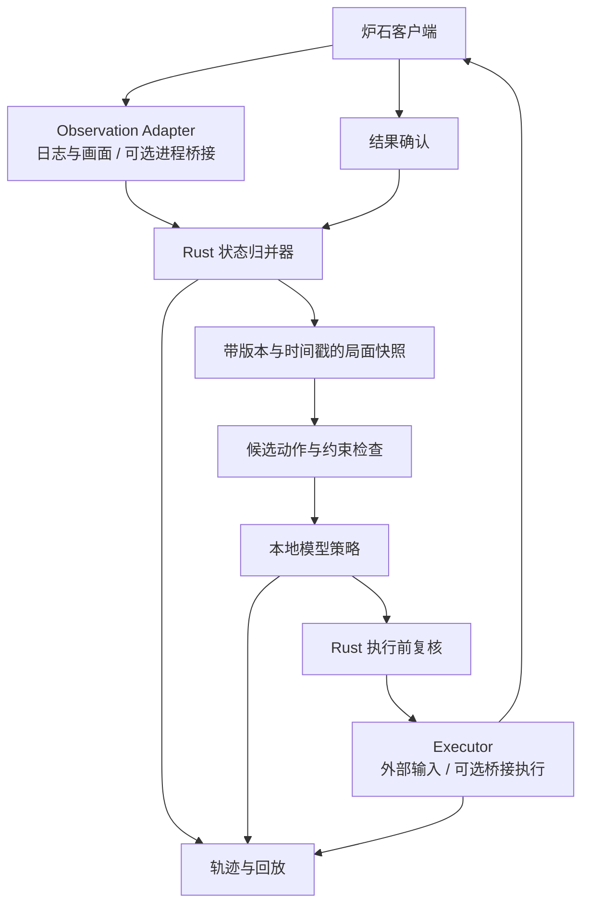

# Rust + 本地决策模型的炉石 Agent 初步设计

状态：初步设计提案（2026-10-26）；现已实现 Rust 工程、日志回放和只读观察。实际进度以 [roadmap](roadmap.md) 和 [局面字段](board.md) 为准，本文其余部分保留原设计目标。

## 决策摘要

建议以 Rust 实现主控、局面归并、动作协议、调度、记录回放与 Windows 外部交互。模型先独立部署在本地进程，通过有版本的接口接入；确认模型格式后再考虑内嵌推理。若采用游戏内部托管对象桥接，再添加薄 C# 适配层，C# 不负责 AI。

“类 jev”的确切模型、输入形式和部署接口尚未明确。本方案把它视为可替换的决策后端，没有假定它是 JEPA、语言模型或已经具备炉石能力。

首版建议范围：Windows、本地单实例、普通构筑模式、固定一套卡组，先在练习/可控对局验证。战棋、佣兵、多账号并行、全卡池模拟不属于首版验收范围。此范围是建议，并非用户已确认的约束。

## 语言分工

| 模块 | 建议 | 原因 |
|---|---|---|
| 状态机、事件归并、任务调度 | Rust | 类型化协议、并发控制、明确所有权和错误处理 |
| 外部窗口、截图、输入 | Rust + windows/windows-sys | Windows API 绑定可用，避免引入额外主控语言 |
| 游戏内托管对象适配（可选） | C# | 与现有托管对象/插件生态衔接更直接 |
| 已有本地模型服务 | 保留原运行时 | 接口解耦，优先沿用模型原生可用实现 |
| 模型训练、实验（如需要） | Python | 与模型作者提供的训练环境保持一致 |
| ONNX 模型推理（可选） | Rust + ort | 需实际验证算子、精度和执行后端兼容性 |

全 Rust 在技术上可做；不建议首版同时重写托管桥接、推理运行时和卡牌模拟器。若目标优先级变成最快复用现有 C# 模拟逻辑，则 C# 主控 + 本地模型服务可能更省工，需重新评估。

## 架构



三个接口独立：`ObservationSource` 提供观测事件；`PolicyBackend` 接受快照和候选，返回选择；`ActionExecutor` 执行动作并返回执行状态。更换数据来源不需要修改策略，更换模型不需要修改输入操作。

## 游戏接入方案与前置验证

### 路线 A：日志 + 画面 + 外部输入，建议先做可行性验证

从 Power.log 等可用记录获得实体变化，配合截图确认菜单、动画、目标选择、发现和卡牌位置。输入层执行鼠标交互。参考 HearthSim 的日志解析事件结构，先用本机真实日志核验格式和信息覆盖。

需要验证：是否能稳定获取我方手牌、实体身份、区域顺序、费用、回合、选择阶段；是否有缺失/延迟；窗口缩放、DPI 和动画下能否准确定位点击区域。不能假定 Power.log 提供完整合法动作或 UI 坐标。

`python-hslog` 能解析 Options/Choices 包，但其默认 EntityTreeExporter 会忽略 Choices、Options、MetaData；直接使用默认导出不能满足动作选择全部需要。必须保留这些事件并核实当前客户端是否实际输出所需数据。

采集不完整时快照标记 `incomplete`，停止自动动作，继续补齐状态。不得将缺失值填 0 或视为空场。

### 路线 B：进程桥接，作为独立工程模块

现有项目已确认 OpenProcess、NtReadVirtualMemory/ReadProcessMemory、远程执行器等基础能力；但 PID 筛选、Mono/GameState 定位和具体实体映射未恢复。因此 GreyMagic 不等于一个已可用的游戏状态 SDK。

若采用该路线：先证明最小只读桥接可以跨多局稳定取得快照，再接入主控。每份快照声明游戏版本、适配器版本、会话、实体 ID 和字段完整度。若选择 C# 游戏内插件，只在合适线程采样/执行，将纯数据传出；推理始终在独立进程，不在游戏线程运行。

Rust 进程不得直接把另一进程的托管对象地址当作 Rust 引用。游戏对象地址只能留在适配层；主控使用会话限定的实体 ID。框架版本、游戏运行时和插件兼容性需实际验证。

两条路线都保留在接口设计中，首版只实现一条通过验证的路线，不同时承担两套接入维护。

## 状态模型与事件协议

每个事件携带 `session_id`、`seq`、采集时间、来源、游戏版本。日志轮换或重连后建立新会话或重建快照，重复事件去重；序列缺口触发重新同步。

快照至少包含：

- `state_id`：对决策有意义的局面版本，避免纯 UI 动画导致无意义失效。
- `phase`：菜单、换牌、对手回合、我方行动、选目标、选择选项、动画、结算。
- 双方英雄/武器、法力、随从、我方手牌、公开历史、当前选择、回合剩余时间（若可用）。
- 卡牌规则版本与动态状态：卡牌 ID、实体 ID、当前费用、增益、可攻击状态等。
- 信息完整度、时间戳、字段来源。对手未知手牌与奥秘显式为 unknown。
- `belief`：推测状态独立存储，不能覆盖已观测事实。

截图是特定时间的观测，需要与结构化快照关联。窗口坐标、DPI 和截图位置属于执行层数据；决策模型默认只选语义动作。

## 动作与模型接口

动作类型建议先覆盖 `Mulligan`、`PlayCard`、`Attack`、`HeroPower`、`ChooseOption`、`EndTurn`、`Wait`，并保留 `UseLocation` 等扩展。`Wait` 是主控动作，不一定是游戏提供的操作。

动作参数使用实体 ID、目标 ID、站位和选项 ID，不用“第三张牌”等易变文字。候选动作 ID 只在指定快照内有效。

示例请求（协议示意，非模型现有 API）：

```json
{
  "protocol_version": 1,
  "session_id": "match-001",
  "decision_id": "decision-018",
  "state_id": 104,
  "budget_ms": 1200,
  "observation": {"phase": "our_action", "mana": 4},
  "candidates": [
    {"id": "a0", "kind": "play_card", "source": 71, "target": 12},
    {"id": "a1", "kind": "end_turn"}
  ]
}
```

```json
{
  "decision_id": "decision-018",
  "state_id": 104,
  "action_id": "a0"
}
```

1200ms 只是接口示例，不是性能承诺。实际预算根据剩余回合时间、模型 p95 延迟、操作与动画耗时动态分配。

模型不能自行创建执行层不存在的动作。候选可能来自游戏提供的选项（若可获取）、规则约束、或两者结合；仅靠“费用足够”无法证明动作合法。未实现机制标记 unsupported，不伪装成合法动作全集。

如果候选过多，可先筛选来源，再选择目标/站位，但要在同一快照下完成验证；不能简单截断前 N 个候选，导致漏掉关键动作。

## 本地模型的三种接入形式

1. **已有语言/多模态模型**：先用本地服务，Rust 发结构化局面、候选和必要图像，要求受约束输出动作 ID；校验输出仍由 Rust 负责。可评估模型实际支持的 llama.cpp server 等后端，不能假定所有模型可用同一格式。
2. **策略/价值网络**：输入局面张量、动作编码和掩码，返回策略分数及可选价值。可采用 Python 推理服务；ONNX 导出和数值等价验证通过后再评估 Rust 内嵌 ort。
3. **潜空间预测/世界模型**：还需要动作条件、策略头或规划器，以及炉石轨迹训练/适配；预测表征不等于可以直接返回炉石动作。模型身份确认后才能决定是否适合这条路线。

“本地运行”不是“已掌握炉石规则”。需要与确定性规则基线比较合法率、延迟、动作完成率和对局表现，不预设大模型一定强于 Silverfish。

## 决策与搜索

第一阶段：让模型在已检查候选中选一步，完成可靠闭环。

第二阶段：模型排序候选，规则/模拟器检查即时后果；增加明确可验证的简单战斗或斩杀分析。

第三阶段：仅在规则模拟覆盖通过验证的卡牌范围内，使用束搜索或其他规划，再用价值网络评估叶节点。未知效果与随机分支必须显式处理；不可将不完整模拟结果当成准确未来。

不建议首版移植全部 1.9 万个 Sim 文件。当前源码已发现空实现；数量不能当作覆盖证明。若临时复用 C# 模拟器，将其作为独立服务，先检查依赖、卡牌版本和具体用例。

## 执行必须是有结果确认的状态机

```text
观察 → 等待稳定 → 构建候选 → 请求模型 → 验证快照未过期
  → 执行一个动作 → 等待可观察结果 → 成功后建立新快照
```

执行前检查会话、局面版本、回合、实体存在、目标、交互阶段和窗口状态。出牌中的放置、战吼目标和抉择是可恢复的子阶段，不能笼统视为一次点击。

使用 `(session_id, decision_id, action_id)` 去重。命令超时不能直接重发鼠标操作：先检查卡牌是否离手、法力是否变化、目标阶段是否已进入。状态不明时报告 `uncertain` 并重新观察。输入动作本身不能假设天然幂等。

模型超时：取消该请求，按剩余预算使用规则基线或等待/结束回合；状态不完整时不盲目结束回合。旧推理结果晚到后必须丢弃。

停止控制应立即阻止后续输入。模型崩溃不应导致输入进程持续点击。无需让模型直接生成脚本或任意操作系统命令。

## 记录、训练和评估

每步保存：原始事件引用、快照、候选集、模型版本/配置、输出、延迟、执行结果、下一快照和可选截图。记录随机种子（适用时）和规则版本。

离线回放验证事件归并的确定性、快照完整度、过期动作拒绝、多阶段交互和超时后的去重。模型评估至少区分非法输出率、实际完成率、p50/p95 延迟与决策质量。

胜率比较使用固定卡组、模式、对手集合和足够样本，并报告不确定性。训练/测试按对局划分，不能把同一局相邻状态随机拆分以夸大泛化效果。对手隐藏信息不能在训练标签构造时意外泄漏到输入。

## 建议目录

```text
hearth-agent/
  crates/
    protocol/          # 带版本的事件、快照、动作
    state/             # 事件归并、完整度检查、状态哈希
    observer/          # 首版日志与画面适配
    rules/             # 候选约束、规则基线
    policy-client/     # 本地模型客户端
    executor-windows/  # 输入和结果确认
    controller/        # 状态机与截止时间
    replay/            # 离线回放与指标
  services/
    model/             # 可选模型原生运行环境
  adapters/
    unity-csharp/      # 仅采用托管桥接路线时实现
  fixtures/
  docs/
```

首版控制消息可使用 localhost HTTP + JSON；若 C# 适配层加入，可使用命名管道或同一 HTTP 协议。无需起步就引入共享内存或复杂 RPC。只绑定本机，明确消息大小、超时和协议版本。

## 实施顺序与验收

| 阶段 | 交付物 | 进入下一阶段的条件 |
|---|---|---|
| 0 | 模型身份确认、接入可行性样本 | 明确模型输入/输出；真实局面关键字段可采集 |
| 1 | Rust 协议、状态归并、离线回放 | 一段完整对局可重建；缺失/重复/轮换有处理 |
| 2 | 规则基线与建议模式 | 每次建议绑定正确快照和实体；不支持机制可识别 |
| 3 | 单步执行闭环 | 出牌、攻击、选目标、结束回合可确认；不盲重试 |
| 4 | 本地模型替换基线 | 合法输出、延迟、结果确认通过；超时降级有效 |
| 5 | 固定卡组完整对局 | 多局稳定完成；所有失败可回放归因 |
| 6 | 搜索增强和覆盖扩展 | 新机制有用例；性能和决策质量有可比指标 |

开发工期和模型大小取决于硬件、模型与接入路线；现阶段不承诺固定天数、显存或胜率。

## 与 Hearthbuddy 的对应关系

| 现有项目 | 新设计 |
|---|---|
| DefaultBot | Rust Controller |
| silverfish_HB / Triton | Observer + StateReducer，桥接可选 |
| Playfield | 版本化快照与可选模拟状态 |
| Movegenerator | CandidateGenerator + Validator |
| Behavior / Ai | PolicyBackend + 可选 Planner |
| DefaultRoutine 的打牌函数 | ActionExecutor + 结果确认 |
| nextMoveGuess | 可选预测；真实结果始终重新核对 |

参考架构和行为，不把受保护 Hearthbuddy/GreyMagic DLL 当新工程的必需依赖。代码复用前核实对应文件许可证。

## 尚待明确

- “类 jev”模型名称/链接、权重格式、截图或结构化输入、现有推理接口。
- GPU/显存、内存和可接受的每步延迟。
- 首个模式与卡组，以及是否坚持进程桥接路线。

## 技术来源

- [微软 windows-rs](https://github.com/microsoft/windows-rs)：Rust Windows API 绑定。
- [HearthSim python-hslog](https://github.com/HearthSim/python-hslog)：Power.log、实体事件和默认导出器的边界。
- [Hearthstone Deck Tracker](https://github.com/HearthSim/Hearthstone-Deck-Tracker)：Windows 炉石跟踪工具参考。
- [BepInEx 插件教程](https://github.com/BepInEx/bepinex-docs/blob/master/articles/dev_guide/plugin_tutorial/2_plugin_start.md/)：C# 插件结构；不是对本机炉石兼容性的承诺。
- [ort](https://github.com/pykeio/ort)：Rust ONNX 推理接口。
- [ONNX Runtime Execution Providers](https://onnxruntime.ai/docs/execution-providers/)：硬件执行后端。
- [llama.cpp server](https://github.com/ggml-org/llama.cpp/tree/master/tools/server)：本地模型服务候选，具体模型兼容性另验。
- 本地《读取机制逆向报告.md》及已检查的 Hearthbuddy 策略源码。
